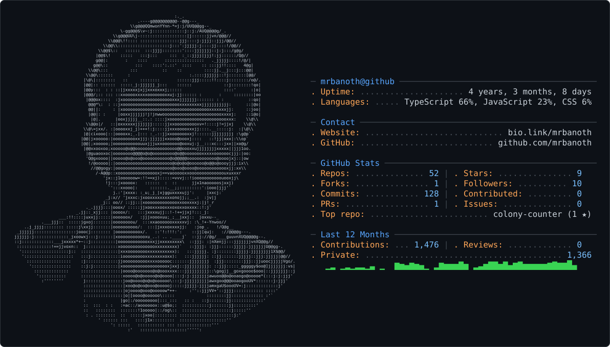

<h2> Hi, I'm Banoth Sandeep Naik!
  <!--  -->
</h2>

<!-- Rounded GIF (smaller + lower position) -->


<p>
  <em>
    Full Stack Developer &amp; UI Engineer • React, Next.js, and MERN
    <br>
    Hyderabad, Telangana • Open to freelance work
  </em>
</p>

<!-- SOCIAL BADGES -->
<p>
  <a href="https://www.linkedin.com/in/banothsandeepnaik">
    
  </a>

  <a href="https://github.com/mrbanoth">
    
  </a>
  
  <a href="https://buymeacoffee.com/mrbanoth">
    
  </a>

  <a href="https://mrbanoth.online">
    
  </a>
</p>

<!-- EXTRA SPACING BEFORE NEXT SECTION -->
<br><br><br>

<h3>
  
  A little more about me...
</h3>

I'm B. Sandeep Naik, a Full Stack Developer and UI Engineer focused on React. I graduated with a **B.Tech in CSE (AI & DS)** from **IIIT Manipur, Senapati** (2022–2026), and I spent **5+ months** as a Frontend UI Developer intern shipping real client work.

I build responsive interfaces with HTML, CSS, JavaScript, React, Next.js, Tailwind CSS, and Bootstrap, including Retro UI. I use ChatGPT, Claude, GitHub Copilot, and Cursor to write cleaner code and debug faster. I'm also learning machine learning, and I know a bit of manual testing and deployment.

```javascript
const sandeep = {
  pronouns: "he" | "him",
  code: ["JavaScript", "TypeScript", "HTML", "CSS", "C"],
  tools: ["React", "Next.js", "Node.js", "Express", "Fastify", "Tailwind", "Bootstrap"],
  data: ["PostgreSQL", "MongoDB", "libSQL", "Redis"],
  also: ["Manual testing", "Deployments"],
  learning: ["Machine Learning", "Backend engineering", "MERN"],
  education: "B.Tech CSE (AI & DS), IIIT Manipur, 2022–2026",
  location: "Hyderabad, Telangana",
  portfolio: "https://mrbanoth.online",
  email: "sandeepnaikb0@gmail.com",
  phone: "+91-9390730129",
  funFact: "I speak funny 😄",
  challenge: "Shipping full-stack products and getting sharper at backend"
}
```

<h3>Featured projects</h3>

More of this work lives on [mrbanoth.online](https://mrbanoth.online).

- **[Petzo](https://mrbanoth.online)** — Real-time pet commerce with auth, live inventory, cart, wishlist, checkout, order tracking, admin, and notifications. Next.js, TypeScript, Go, PostgreSQL, Redis. Live.
- **[Artville Interiors](https://mrbanoth.online)** — Editorial site for an interior studio: projects, services, and studio stories. Next.js, TypeScript, Fastify, libSQL. Live.
- **[Tribal Development Trust](https://tdt-main.vercel.app)** — NGO site for tribal development work in Andhra Pradesh and Telangana. React, Vite, Tailwind CSS. Live.
- **[The Village Cuts](https://thevillagecuts.com)** — Freelance meat e-commerce for thevillagecuts.com: React frontend, PHP backend, SQL, and Razorpay. In progress.
- **[Sri Sanari Infrastructure](https://github.com/mrbanoth/srisanari-infra)** — Real-estate site with listings, SMTP email forms, and a Contentful CMS, built during internship. Next.js. Live.

<h3>Stack</h3>

`HTML` `CSS` `JavaScript` `TypeScript` `React` `Next.js` `Node.js` `Express` `Fastify` `Tailwind` `Bootstrap` `PostgreSQL` `MongoDB` `Git` `Vite`

Integrations and AI tools: Supabase, EmailJS, Framer, Radix UI, ChatGPT, Claude, GitHub Copilot, Cursor, v0.

Always learning — backend with Node.js, Express, and databases, plus machine learning.
